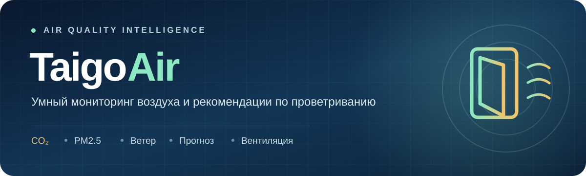
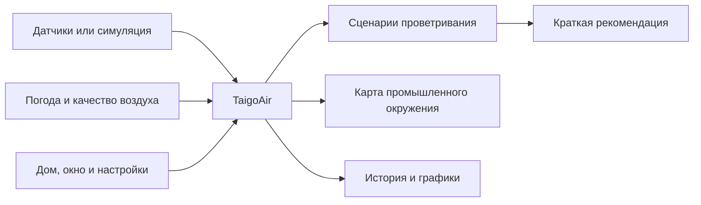

<div align="center">



<br />


**Веб-приложение для мониторинга микроклимата, анализа наружного воздуха и предварительного расчёта проветривания.**

[Возможности](#-возможности) · [Как это работает](#-как-это-работает) · [Установка](#-быстрый-старт) · [API](#-api) · [Планы](#-планы-развития)

</div>

---

## ✨ О проекте

**TaigoAir** объединяет данные о воздухе в помещении, погодные условия, прогноз загрязнения атмосферы и информацию о промышленных предприятиях. На основе выбранных параметров комнаты приложение строит **демонстрационные сценарии проветривания** и объясняет, почему тот или иной сценарий подходит или не подходит.

> [!IMPORTANT]
> **TaigoAir — прототип.** При отсутствии физических датчиков используются тестовые данные. Расчёт воздухообмена не откалиброван, а условные промышленные шлейфы **не являются измерением выбросов** и не подтверждают загрязнение воздуха по конкретному адресу.

## 🚀 Возможности

| Модуль | Что умеет |
|:--|:--|
| 🏠 **Главная** | Быстрый обзор CO₂, PM2.5, наружной температуры, состояния окна и рекомендации |
| 🌬️ **Проветривание** | Сценарии на 5–20 минут, сравнение CO₂, PM2.5, температуры и примерных теплопотерь |
| 🕒 **Прогноз воздуха** | Модельные значения PM2.5, EU AQI и ветра через **3 / 6 / 12 часов** |
| 🏭 **Промышленное окружение** | Карта предприятий Омска, направление ветра и возможная направленность переноса |
| 🧪 **TaigoPlume** | Иллюстративная модель распространения вещества при условных параметрах выброса |
| 📈 **История** | Сохранённые измерения, графики и выбор периода |
| ⚙️ **Настройки** | Параметры дома, режим окна, пороги качества воздуха и параметры модели |
| 🔬 **Эксперименты** | Режимы запуска и сохранения результатов экспериментов с воздухообменом |

## 🧭 Как это работает



TaigoAir разделяет **показания внутри помещения**, **модельные наружные данные** и **оценку промышленного переноса по ветру**. Наличие предприятия на пути ветра не означает, что его выбросы достигли дома.

## 🛠️ Технологии

| Уровень | Стек |
|:--|:--|
| Backend | Python, Flask, Jinja2 |
| Frontend | HTML, CSS, JavaScript |
| Карты | Leaflet |
| Данные | SQLite, JSON |
| Погода и наружный воздух | Open-Meteo |
| Расчёты | Сервисы вентиляции, прогноза и иллюстративной дисперсии |

## ⚡ Быстрый старт

**1. Клонируйте репозиторий** (или скачайте ZIP на GitHub):

```bash
git clone <URL_ВАШЕГО_РЕПОЗИТОРИЯ>
cd <ИМЯ_ПАПКИ_РЕПОЗИТОРИЯ>
```

**2. Создайте виртуальное окружение и установите зависимости:**

```bash
python3 -m venv .venv
source .venv/bin/activate
pip install -r requirements.txt
```

<details>
<summary><b>Windows: активация виртуального окружения</b></summary>

```powershell
.venv\Scripts\activate
```

</details>

**3. Запустите приложение:**

```bash
python main.py
```

**4. Откройте** [http://127.0.0.1:5000](http://127.0.0.1:5000).

> [!NOTE]
> Для получения наружной погоды и качества воздуха требуется интернет-соединение. Первый запуск создаёт необходимые таблицы SQLite. Текущий запуск Flask настроен для локальной разработки (`debug=True`) и **не предназначен для публичного production-сервера**.

## 📂 Структура проекта

```text
TaigoAir/
├── main.py                   # Flask и HTTP-маршруты
├── requirements.txt          # Зависимости
├── data/                     # Справочники предприятий и веществ
├── services/                 # Расчёты, БД, погода и данные датчиков
│   ├── database.py
│   ├── ventilation.py
│   ├── recommendations.py
│   ├── outdoor_forecast.py
│   ├── wind_analysis.py
│   └── dispersion.py
├── templates/                # Страницы Jinja2
├── static/
│   ├── css/                  # Оформление
│   ├── js/                   # Логика интерфейса
│   └── images/               # Изображения интерфейса
├── tests/                    # Автоматизированные тесты
└── assets/                   # Графика для README
```

## 🔌 API

| Метод и адрес | Назначение |
|:--|:--|
| `GET /api/sensors` | Данные датчиков или симуляции |
| `GET /api/weather` | Погодные данные |
| `GET /api/air-quality` | Наружное качество воздуха |
| `GET /api/outdoor-forecast` | Прогноз на 3 / 6 / 12 часов |
| `GET /api/industry` | Предприятия и анализ ветра |
| `GET /api/plume` | Учебная модель шлейфа |
| `GET /api/forecast/scenarios` | Сценарии и рекомендации |
| `GET /api/window-mode` | Текущий выбранный режим окна |
| `POST /api/window-mode` | Сохранение выбранного режима |

Пример запроса после запуска:

```bash
curl http://127.0.0.1:5000/api/outdoor-forecast
```

Полный список маршрутов и форматы ответов определены в [`main.py`](main.py).

## 🧪 Тестирование

Для проверки синтаксиса Python:

```bash
python3 -m compileall -q main.py services
```

Для запуска тестов при установленном `pytest`:

```bash
python3 -m pytest tests -q
```

> Наличие тестов в репозитории не означает, что все они успешно проходят на каждом окружении. Проверяйте также поведение интерфейса, настройки и ответы API.

## 🗺️ Планы развития

- [ ] Сравнивать текущие наружные условия с прогнозом на 3/6/12 часов при рекомендации времени проветривания
- [ ] Добавить журнал изменений режима окна и отображение этих событий в истории
- [ ] Подключить реальные датчики и обработку потери связи
- [ ] Откалибровать модель воздухообмена на измерениях
- [ ] Дополнить модель промышленного переноса проверенными характеристиками источников выбросов
- [ ] Расширить автоматические и мобильные тесты

## ⚠️ Ограничения и интерпретация

- **CO₂ и частицы внутри** могут быть тестовыми значениями, а не показаниями устройств.
- **Open-Meteo** предоставляет модельные наружные данные, не измерения непосредственно у окна.
- **TaigoPlume** использует условные параметры выбросов. Его результаты нельзя интерпретировать как реальные концентрации загрязнителей.
- **Рекомендованные минуты** — предварительная оценка, зависящая от сценария и настроек. Она не гарантирует достижение заданного качества воздуха.
- **Выбранный режим окна** и фактическое состояние окна по датчику — разные сущности.

---

<div align="center">

### 🌿 TaigoAir

**Понимай воздух вокруг. Принимай решения осознанно.**

<sub>Развивающийся исследовательский прототип • Python + Flask</sub>

</div>
